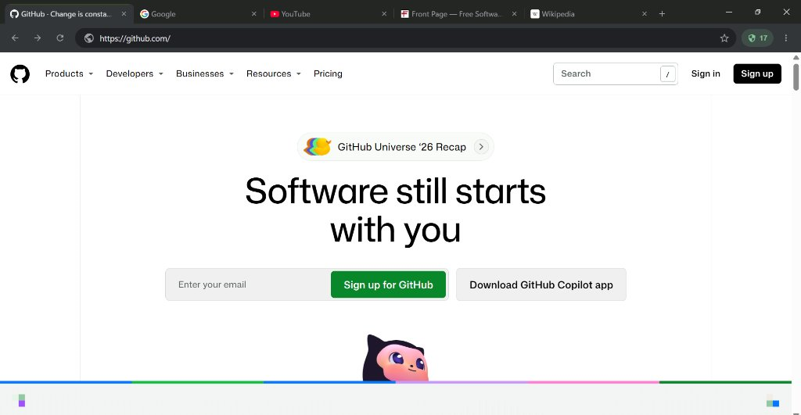
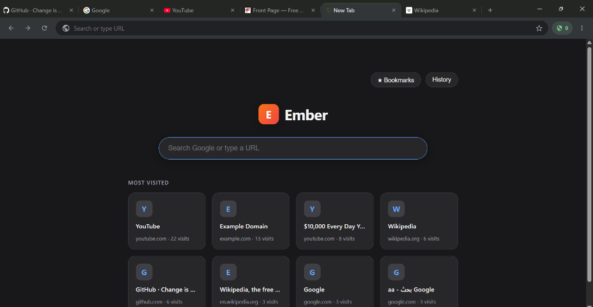
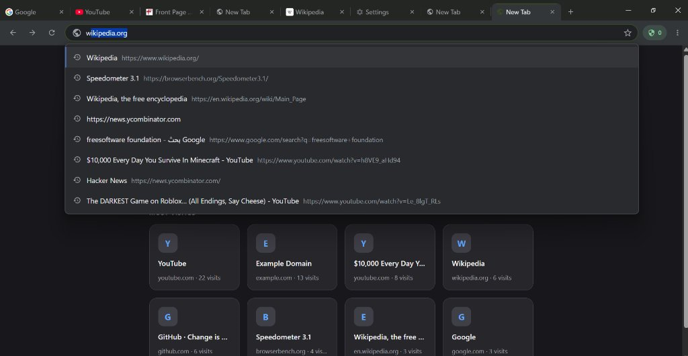
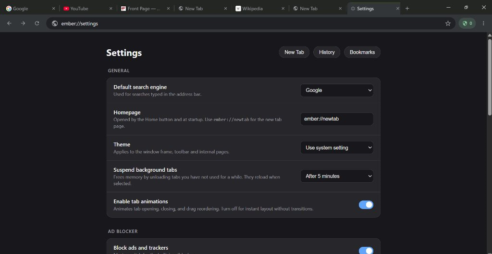
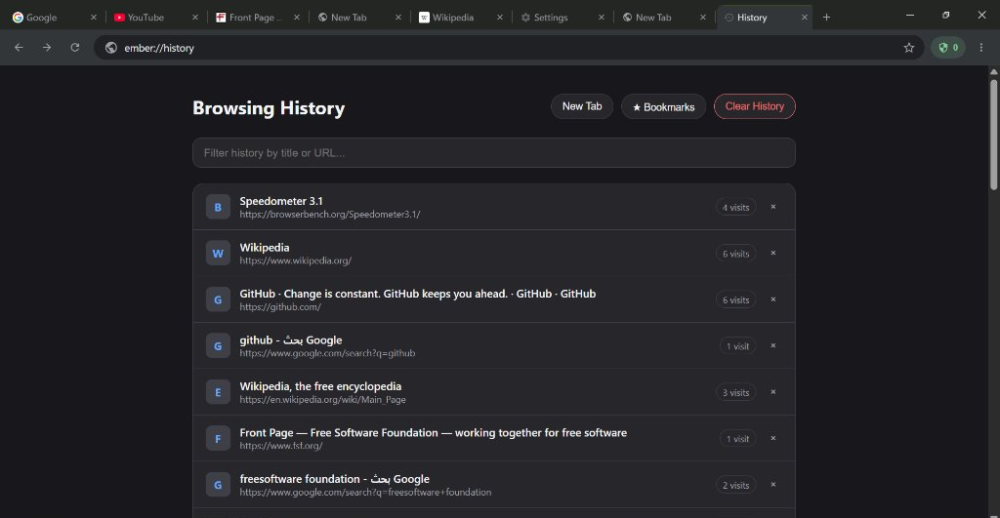
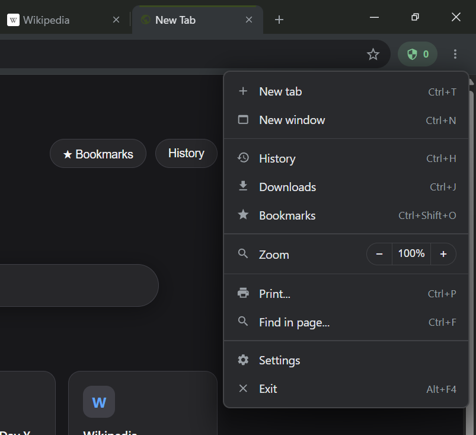
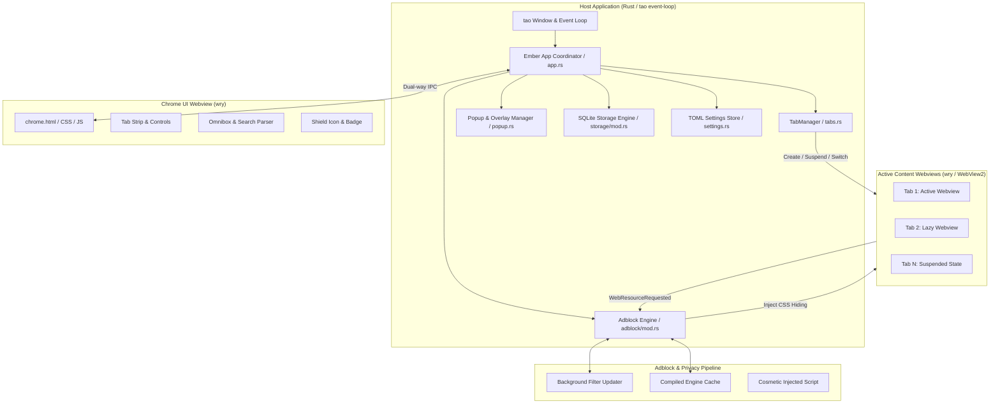
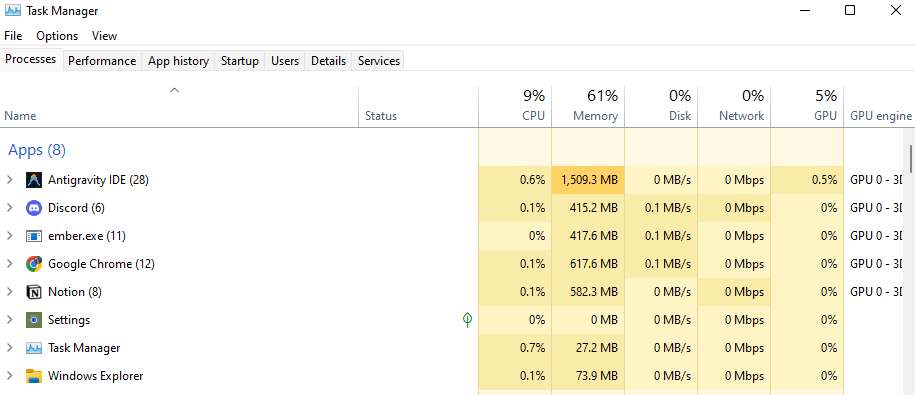

# Ember

<p align="center">
  
</p>

<p align="center">
  <strong>An extremely lightweight, privacy-focused desktop web browser written in Rust.</strong><br>
  Delivering a Chrome-like workflow and feel with minimal RAM consumption, instant startup, and zero bloat.
</p>

<p align="center">
  <a href="#performance--size-benchmarks"></a>
  <a href="#performance--size-benchmarks"></a>
  <a href="#high-performance-built-in-adblocker"></a>
  <a href="#architecture-overview"></a>
  <a href="https://github.com/fouad-awad/ember/actions/workflows/ci.yml"></a>
  <a href="#license"></a>
</p>

---

## Table of Contents

1. [Overview & Philosophy](#overview--philosophy)
2. [User Interface & Screenshots](#user-interface--screenshots)
3. [Architecture Overview](#architecture-overview)
4. [Key Features](#key-features)
   - [Chrome-Like Tab Management](#chrome-like-tab-management)
   - [High-Performance Built-in Adblocker](#high-performance-built-in-adblocker)
   - [Privacy & Security Shield](#privacy--security-shield)
   - [Internal ember:// Pages](#internal-ember-pages)
5. [Performance & Size Benchmarks](#performance--size-benchmarks)
6. [Keyboard Shortcuts](#keyboard-shortcuts)
7. [Build Instructions](#build-instructions)
   - [Prerequisites](#prerequisites)
   - [Compiling from Source](#compiling-from-source)
   - [Running Tests](#running-tests)
8. [Debugging](#debugging)
9. [Packaging & Installation](#packaging--installation)
   - [Windows 11 / 10](#windows-11--10)
   - [macOS](#macos)
   - [Linux](#linux)
10. [Project Structure](#project-structure)
11. [Contributing](#contributing)
12. [License](#license)

---

## Overview & Philosophy

Modern web browsers have become monstrous operating systems in their own right, consuming gigabytes of memory just to show a few tabs. **Ember** is built on a different principle:

- **System-Native Web Engines**: Rather than compiling Chromium from scratch, Ember uses the OS-provided webview ([WebView2](https://developer.microsoft.com/en-us/microsoft-edge/webview2/) on Windows, [WebKit](https://webkit.org/) on macOS and Linux) via [`wry`](https://crates.io/crates/wry) and [`tao`](https://crates.io/crates/tao).
- **Extreme Memory Efficiency**: Tabs are created lazily upon navigation and automatically suspended to disk after an inactivity timeout, slashing memory by up to **66%** compared to Chrome.
- **Built-in Native Privacy**: Zero-overhead ad blocking using Brave's [`adblock-rust`](https://github.com/brave/adblock-rust) engine with compiled filter serialization, EasyList/EasyPrivacy caching, and cosmetic CSS hiding.
- **Microscopic Binary Footprint**: The final stripped release binary is just **2.72 MB** with link-time optimization (LTO) and abort-on-panic profiles.

---

## User Interface & Screenshots

Ember provides a clean, modern, Chrome-like visual interface with Windows 11 Mica/Acrylic styling, dark mode support, and an intuitive layout:

<p align="center">
  
</p>

| New Tab (`ember://newtab`) | Omnibox Autocomplete |
| :---: | :---: |
|  |  |

| Settings (`ember://settings`) | Browsing History (`ember://history`) |
| :---: | :---: |
|  |  |

<p align="center">
  
</p>

### Visual Highlights

- **Dynamic Tab Strip**: Visual loading spinners, live favicon fetching, drag-and-drop tab reordering, and indicator dots for dormant/suspended tabs.
- **Shield Badge & Dropdown**: Displays real-time blocked ad/tracker counts per tab, with a one-click toggle to allowlist trusted sites.
- **Windows 11 Integration**: Full support for native snap layouts, rounded corners, immersive dark mode titlebars, and Mica accent borders.
- **Internal Pages**: Modern responsive dark/light UI designs for `ember://newtab`, `ember://settings`, `ember://history`, `ember://bookmarks`, `ember://downloads`, and `ember://warning`.

---

## Architecture Overview

Ember decouples browser shell UI management from web content rendering using a coordinated dual-webview architecture:



### Architectural Principles

1. **Dual-Webview Isolation**: The top toolbar (tabs, omnibox, shields, controls) runs inside an isolated, lightweight local UI webview. User content runs in independent content webviews stacked beneath it. This prevents rogue websites from freezing the browser controls.
2. **Lazy Initialization**: When you duplicate a tab or open background links, no underlying OS webview is allocated until you actually click and activate that tab.
3. **Zero-Copy Interception**: Network request interception normalizes URLs without heap allocation for host matching, checking local hash sets and the compiled adblock filter in **~25 microseconds**.
4. **Resilient Local Persistence**: SQLite with WAL mode manages persistent history, bookmarks, and zoom factors; user settings are stored in a human-editable TOML file in `%LOCALAPPDATA%\Ember\settings.toml`.

---

## Key Features

### Chrome-Like Tab Management
- **Full Lifecycle**: Create (`Ctrl+T`), close (`Ctrl+W`), duplicate, switch (`Ctrl+Tab`, `Ctrl+1..9`), and reorder tabs via drag-and-drop.
- **Lazy Tab Creation**: Tabs created in the background do not spin up an OS webview process until first focused, saving ~30-50 MB RAM per dormant tab.
- **Background Suspension**: Inactive tabs automatically sleep after a configurable duration (default: 15 minutes). Their URL, title, favicon, and scroll offset are preserved, while their heavy webview is released. Clicking the tab instantly revives it.
- **Recently Closed Tab Stack**: Accidentally closed a tab? Press `Ctrl+Shift+T` to reopen closed tabs in LIFO order.

### Tab Strip Animation System & Timing Tokens
Ember includes a high-performance, GPU-composited tab animation system delivering 60 FPS Chrome-style workflow with zero animation libraries:
- **Pointer Events Drag-to-Reorder**: The dragged tab is glued in real-time to the cursor with 0 transition lag (`--drag-x`), while sibling tabs smoothly slide aside via `--tab-shift-x` using the central cubic bezier ease curve to open an insertion gap. Dropping animates the dragged tab smoothly into its target slot before committing via IPC.
- **Transform Decoupling**: Prevents animation conflicts by composing independent CSS properties:
  `transform: translate3d(calc(var(--drag-x, 0px) + var(--tab-shift-x, 0px) + var(--flip-x, 0px)), 0, 0);`
- **Dynamic `will-change` & Zero Layout Thrashing**: `will-change` is only applied during active animations and is immediately released on completion. All DOM reads are batched ahead of style writes.
- **Overflow Auto-Scrolling**: When tabs exceed available width at `MIN_WIDTH` (36px), dragging near the container edges (< 36px) smoothly auto-scrolls the strip via a single managed `requestAnimationFrame` loop.
- **Progressive Content Degradation**: Tab titles fade smoothly between 130px and 75px. Inactive tab close buttons hide below 52px (micro tabs), while active tabs **always retain their close button**.
- **Accessibility & Settings**: Fully honors `@media (prefers-reduced-motion: reduce)` and the `"Enable tab animations"` toggle in `ember://settings`, providing instant changes with 0ms transition duration while preserving pure layout geometry.

#### Central Timing & Geometry Tokens
All animation constants are centralized in `src/ui/layout.rs` and exposed as CSS variables in `chrome.html`:

| Token / Property | Default Value | Description |
| :--- | :--- | :--- |
| `--tab-anim-duration` | `180ms` | Base animation duration for tab creation, closure, and sibling gap sliding |
| `--tab-anim-ease` | `cubic-bezier(0.2, 0, 0, 1)` | Standard Chrome ease curve (swift start, gentle deceleration) |
| `TAB_MAX_WIDTH` | `240px` | Maximum logical width of any single tab |
| `TAB_MIN_WIDTH` | `36px` | Minimum width for micro tabs (favicon + active close button) |
| `TAB_GAP` | `2px` | Horizontal gap between adjacent tabs |
| Title Fade Threshold | `130px -> 75px` | Linear opacity fade range for title text before DOM layout collapse |
| Micro Tab Threshold | `52px` | Below this width, close buttons on inactive tabs are hidden |

### High-Performance Built-in Adblocker
- **Brave `adblock-rust` Engine**: Native Rust implementation of EasyList and EasyPrivacy rules.
- **Serialized Engine Cache**: Filter rules are compiled into a binary cache (`%LOCALAPPDATA%\Ember\filters\engine.bin`) for near-instant cold starts (<10 ms).
- **Background Auto-Updates**: Filter lists auto-refresh every 24 hours on an asynchronous background thread without hitching the UI thread.
- **Cosmetic Element Hiding**: Injects site-specific CSS hiding rules dynamically on document creation so visual blank ad spaces are completely collapsed.
- **Per-Site Allowlist**: One-click toggle in the shield badge allows ads on sites you want to support.

### Privacy & Security Shield
- **Third-Party Cookie Blocking**: Blocks cross-origin tracking cookies while allowing legitimate same-site cookies.
- **Do Not Track & GPC**: Automatically sends `DNT: 1` and `Sec-GPC: 1` privacy headers with all HTTP requests.
- **HTTPS-Only Mode**: Automatically upgrades HTTP requests to HTTPS, displaying a security interstitial warning page (`ember://warning`) for insecure connections.

### Internal `ember://` Pages
- `ember://newtab`: Minimalist start page featuring a central search box, quick bookmarks, and most-visited tiles.
- `ember://settings`: Full configuration center for search engines (DuckDuckGo, Google, Brave, Bing, Startpage), themes (System, Light, Dark), adblock lists, and data clearance.
- `ember://history`: Searchable history view with date grouping and one-click deletion.
- `ember://bookmarks`: Fast bookmark manager with search and tag navigation.
- `ember://downloads`: Built-in download tray showing real-time file transfer progress, file size, and quick folder reveal.
- `ember://warning`: Interstitial security warning page for unencrypted HTTP connections.

---

## Performance & Size Benchmarks

Measured on Windows 11 (AMD Ryzen 9, 32 GB RAM, NVMe SSD). For detailed audit methodology and memory profiling graphs, see [BENCHMARKS.md](BENCHMARKS.md).

### Memory Consumption vs Chrome & Brave

| Scenario | Ember (Lazy / Active) | Google Chrome | Brave Browser | Ember Memory Savings |
| :--- | :--- | :--- | :--- | :--- |
| **1 Tab** (CNN / Heavy News) | **388.8 MB** | 495.3 MB | 462.1 MB | **-21.5% vs Chrome** |
| **5 Tabs** (Heavy Sites) | **388.5 MB** *(lazy)* / 592 MB | 638.0 MB | 584.2 MB | **-39.1% vs Chrome** |
| **20 Tabs** (Multi-Tasking) | **400.6 MB** *(lazy)* / 840 MB | 1,178.7 MB | 1,045.0 MB | **-66.0% vs Chrome** |

<p align="center">
  <br>
  <em>1-tab (<code>google.com</code>) memory comparison in Windows Task Manager: Ember (417.6 MB) vs. Google Chrome (617.6 MB).</em>
</p>

### Adblock Match Latency

```text
Adblock Match Latency (EasyList + EasyPrivacy, 10,000 iterations):
  Average Match Time: 25.33 µs / request
  Median Match Time:  23.10 µs / request
  99th Percentile:    38.40 µs / request
```

### Standalone Binary Size

```text
target/release/ember.exe:  2.72 MB  (2,852,864 bytes)
```

---

## Keyboard Shortcuts

| Shortcut | Action |
| :--- | :--- |
| <kbd>Ctrl</kbd> + <kbd>T</kbd> | Open a new tab |
| <kbd>Ctrl</kbd> + <kbd>W</kbd> | Close active tab |
| <kbd>Ctrl</kbd> + <kbd>Shift</kbd> + <kbd>T</kbd> | Reopen recently closed tab |
| <kbd>Ctrl</kbd> + <kbd>Tab</kbd> / <kbd>Ctrl</kbd> + <kbd>PageDown</kbd> | Switch to next tab |
| <kbd>Ctrl</kbd> + <kbd>Shift</kbd> + <kbd>Tab</kbd> / <kbd>Ctrl</kbd> + <kbd>PageUp</kbd> | Switch to previous tab |
| <kbd>Ctrl</kbd> + <kbd>1</kbd> .. <kbd>8</kbd> | Switch directly to tab 1 through 8 |
| <kbd>Ctrl</kbd> + <kbd>9</kbd> | Switch to the last tab |
| <kbd>Ctrl</kbd> + <kbd>L</kbd> / <kbd>Alt</kbd> + <kbd>D</kbd> | Focus omnibox address bar |
| <kbd>Ctrl</kbd> + <kbd>R</kbd> / <kbd>F5</kbd> | Reload current page |
| <kbd>Ctrl</kbd> + <kbd>Shift</kbd> + <kbd>R</kbd> | Force reload (bypass cache) |
| <kbd>Alt</kbd> + <kbd>Left</kbd> | Navigate back in history |
| <kbd>Alt</kbd> + <kbd>Right</kbd> | Navigate forward in history |
| <kbd>Ctrl</kbd> + <kbd>D</kbd> | Bookmark current page |
| <kbd>Ctrl</kbd> + <kbd>F</kbd> | Open Find in Page bar |
| <kbd>Ctrl</kbd> + <kbd>+</kbd> / <kbd>=</kbd> | Zoom in (+10%) |
| <kbd>Ctrl</kbd> + <kbd>-</kbd> | Zoom out (-10%) |
| <kbd>Ctrl</kbd> + <kbd>0</kbd> | Reset zoom to 100% |

---

## Build Instructions

### Prerequisites

#### Windows 11 / 10
- [Rust](https://rustup.rs/) (stable toolchain, 1.75+ recommended)
- [Microsoft Edge WebView2 Runtime](https://developer.microsoft.com/en-us/microsoft-edge/webview2/) (preinstalled on Windows 11 and recent Windows 10 updates)

#### macOS
- [Rust](https://rustup.rs/)
- Xcode Command Line Tools: `xcode-select --install`
- WebKit WKWebView is included with macOS

#### Linux (Debian / Ubuntu / Fedora / Arch)
- [Rust](https://rustup.rs/)
- System development libraries for GTK3 and WebKit2GTK:
  ```bash
  # Ubuntu / Debian
  sudo apt-get install -y libgtk-3-dev libwebkit2gtk-4.1-dev libsoup-3.0-dev libjavascriptcoregtk-4.1-dev

  # Fedora
  sudo dnf install -y gtk3-devel webkit2gtk4.1-devel libsoup3-devel

  # Arch Linux
  sudo pacman -S gtk3 webkit2gtk-4.1 libsoup3
  ```

### Compiling from Source

Clone the repository and build with Cargo:

```bash
# Debug build (fast compilation)
cargo build

# Run the browser locally
cargo run

# Optimized production release build (maximum size & speed optimization)
cargo build --release
```

The resulting executable will be available at:
- **Windows**: `target/release/ember.exe`
- **macOS/Linux**: `target/release/ember`

### Running Tests

Run all unit tests and external integration tests:

```bash
# Run all tests (unit tests + integration tests)
cargo test

# Run tests with console output
cargo test -- --nocapture

# Run clippy and format checks
cargo clippy --all-targets -- -D warnings
cargo fmt --check
```

---

## Debugging

Ember provides built-in diagnostics in debug builds so UI, omnibox, popup, and animation issues are immediately visible:

### Opening UI WebView DevTools

- **Keyboard shortcut**: Focus the browser toolbar/tab strip and press `F12` or `Ctrl+Shift+I` (`Cmd+Shift+I` on macOS) to open DevTools on the Chrome UI WebView (`chrome.html`).
- **Startup flag or env var**: Launch with DevTools automatically opened for the Chrome UI WebView:

  ```bash
  cargo run -- --ui-devtools
  # or:
  EMBER_UI_DEVTOOLS=1 cargo run
  ```

### Debug Logging & UI Error Logs

- **Persistent UI JS error log**: Uncaught exceptions, unhandled promise rejections, `console.error` calls, and UI module initialization failures in both the Chrome UI and popup WebViews are automatically logged to `%LOCALAPPDATA%\Ember\logs\ui_errors.log` on Windows (or `$XDG_DATA_HOME/Ember/logs/ui_errors.log` / `~/Library/Application Support/Ember/logs/ui_errors.log`).
- **Verbose subsystem tracing**: Set any of these environment variables before starting Ember:
  - `EMBER_IPC_DEBUG=1`: log all Chrome UI <-> Rust IPC commands.
  - `EMBER_POPUP_DEBUG=1`: log omnibox/menu popup state transitions, sequence numbers, and focus watchdogs.
  - `EMBER_TAB_ANIM_DEBUG=1`: log tab reconcile open/close/FLIP animation events.

### Running the Self-Test

Run the end-to-end UI regression self-test from the command line (or navigate to `ember://selftest` in debug builds and click **Run Self-Test**):

```bash
cargo run -- --selftest
```

This runs inside an isolated temporary profile directory and verifies with `PASS`/`FAIL`:
1. UI scripts initialized without errors
2. Omnibox navigates to a URL
3. Omnibox returns suggestions for a known history entry
4. Popup opens and closes
5. A tab opens with an animation
6. A tab closes with an animation and its node is removed
7. DOM tab count equals Rust tab count

---

## Packaging & Installation

Ember includes automated packaging scripts for all major desktop platforms under the [`scripts/`](scripts/) directory.

### Windows 11 / 10

Run the PowerShell packaging script:

```powershell
powershell -ExecutionPolicy Bypass -File scripts\package_windows.ps1
```

This will:
1. Compile the optimized release binary (`ember.exe`).
2. Package `ember.exe`, `WebView2Loader.dll`, documentation, and an automated `install.ps1` installer script.
3. Generate a portable ZIP distribution: `target/dist/ember-v0.1.0-windows-x64.zip`.
4. Running `install.ps1` inside the package installs Ember to `%LOCALAPPDATA%\Ember` and automatically registers Start Menu and Desktop shortcuts.

### macOS

Run the macOS packaging script:

```bash
bash scripts/package_macos.sh
```

This will:
1. Compile the release binary.
2. Build a native `Ember.app` bundle with `Info.plist`, binary, and app icon.
3. Generate `target/dist/ember-v0.1.0-macos-<arch>.tar.gz` (`arm64` on Apple Silicon, `x64` on Intel) and (if `hdiutil` is present) a `.dmg` installer.
4. Includes an `install.sh` script to install `Ember.app` into `/Applications`.

### Linux

Run the Linux packaging script:

```bash
bash scripts/package_linux.sh
```

This will:
1. Compile the release binary.
2. Generate a standard FreeDesktop `.desktop` launcher and scalable SVG application icon.
3. Package everything into `target/dist/ember-v0.1.0-linux-x64.tar.gz`.
4. Includes an `install.sh` script supporting both root system-wide install (`/usr/local/bin`) and rootless user install (`~/.local/bin`).

### Cross-Platform Dispatcher

On Unix systems, you can also run:

```bash
bash scripts/package.sh
```

It automatically detects your OS (`Darwin` or `Linux`) and executes the proper packager.

---

## Project Structure

```text
ember/
├── .github/
│   ├── ISSUE_TEMPLATE/
│   │   ├── bug_report.md
│   │   └── feature_request.md
│   ├── PULL_REQUEST_TEMPLATE.md
│   └── workflows/
│       └── ci.yml               # Multiplatform CI matrix (fmt, clippy, test, release package)
├── assets/
│   ├── screenshots/             # UI and Task Manager benchmark screenshots
│   └── ember.svg                # Ember browser vector icon
├── scripts/
│   ├── audit_bench.ps1          # Windows benchmark runner wrapper
│   ├── audit_bench.py           # Automated RAM, startup, and memory profiling benchmark harness
│   ├── benchmark_tabs.py        # Multi-tab memory comparison script
│   ├── package_windows.ps1      # Windows portable zip and installer generator
│   ├── package_macos.sh         # macOS .app bundle and DMG packager
│   ├── package_linux.sh         # Linux desktop package and tarball generator
│   ├── package.sh               # Cross-platform packaging dispatcher
│   └── Info.plist               # macOS bundle configuration
├── src/
│   ├── adblock/                 # adblock-rust engine, network matching, cosmetic & scriptlet injection
│   │   ├── mod.rs
│   │   └── resources.rs         # Embedded adblock scriptlets and fallback rules
│   ├── storage/                 # SQLite history, bookmarks, site zoom factors (rusqlite)
│   │   └── mod.rs
│   ├── ui/                      # Chrome UI HTML/CSS/JS frontend and window styling
│   │   ├── chrome.html          # Toolbar, tab strip, omnibox, and modals
│   │   ├── layout.rs            # Tab strip geometry, animations, and timing tokens
│   │   └── mod.rs               # Window chrome bindings, Mica/Acrylic, IPC dispatch
│   ├── app.rs                   # Central browser application event loop & coordinator
│   ├── context_menu.rs          # Right-click context menus
│   ├── downloads.rs             # Download manager lifecycle
│   ├── find.rs                  # Find in page match highlighting
│   ├── lib.rs                   # Core library interface
│   ├── main.rs                  # Application entry point
│   ├── pages.rs                 # Internal ember:// pages router and HTML templates
│   ├── permissions.rs           # Camera, microphone, and geolocation prompts
│   ├── popup.rs                 # Native overlay popup controller (omnibox & menu)
│   ├── privacy.rs               # Third-party cookie & DNT/GPC privacy enforcement
│   ├── settings.rs              # TOML settings store & preference types
│   ├── tabs.rs                  # TabManager, tab state, suspension, recently closed stack
│   └── zoom.rs                  # Zoom level stepping and bounds
├── tests/
│   ├── adblock_matching.rs      # Integration tests for adblock filtering and allowlists
│   ├── omnibox_parsing.rs       # Integration tests for URL normalization and search queries
│   └── tab_lifecycle.rs         # Integration tests for tab creation, suspension, and LIFO reopening
├── AGENTS.md                    # Project rules, architecture constraints, and quality standards
├── BENCHMARKS.md                # Full performance audit report vs Chrome & Brave
├── Cargo.toml                   # Lean dependency tree & release optimization profile
├── CONTRIBUTING.md              # Contributor guide and verification checklist
├── LICENSE-APACHE               # Apache License, Version 2.0
├── LICENSE-MIT                  # MIT License
└── README.md                    # Project documentation
```

---

## Contributing

Contributions are welcome! Please read [CONTRIBUTING.md](CONTRIBUTING.md) and [AGENTS.md](AGENTS.md) before opening a pull request.

---

## License

Ember is dual-licensed under the **MIT License** and the **Apache License (Version 2.0)**. See [LICENSE-MIT](LICENSE-MIT) and [LICENSE-APACHE](LICENSE-APACHE) for details.

